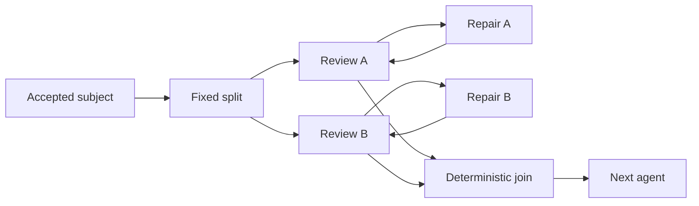

# Fixed workflow graph implementation

## Status and scope

This is the narrowed implementation contract. It adds fixed split/join graphs to
the existing host. Hypothesis development and research investigation retain their
existing phase sequences, prompts, tool policies and scientific decisions. In
particular, research still has one critic. Enabling two critics is a separate
workflow-definition change, not part of this update.

The implementation reuses the accepted transition journal, revision CAS,
execution ownership guards, conversation service and durable work store. There
is no additional scheduler, graph database, receipt store, transaction framework,
model checker, or compatibility engine.

## Authored topology

An ordinary node chooses one declared successor. A `SplitPhase` declares a fixed
mapping of branch names to entry nodes and its matching join. The join is an
existing `DeterministicPhase` with one successor. Only an explicit split creates
concurrency; ordinary decisions and loopbacks move one current position.

Each sequential branch has at most one current position. A nested split suspends
that position, opens its declared child branches, then restores one position at
its join. Distinct branches can loop independently. After a region closes, an
outer loop may enter it again with fresh attempt identities and no reused arrivals.
This expresses the intended restriction more precisely than forbidding two nodes
in the same graph-theoretic cycle.

The compiler checks declared nodes and edges, one matching deterministic join per
split, disjoint sibling ownership, proper nesting, join reachability and terminal
placement. Branches cannot cross into siblings, bypass a join with success, or
share executable nodes. An explicitly declared failure terminal aborts the whole
execution. These checks establish the supported structural grammar; they do not
prove that a model will terminate its loops or choose a useful scientific action.

Dynamic branch counts, copied subgraphs, arbitrary unstructured merges, optional
branches, quorum joins and branch-local success terminals are outside this contract.

## Control and domain boundaries

`thesis_runtime/workflows/graph/topology.py` validates the fixed definition.
`graph/control.py::replay_graph` reconstructs the active positions and open regions
from accepted history. Both are pure functions with no storage or provider calls.

The workflow host owns control, identity, acceptance, lifecycle and dispatch.
Extensions own their domain fold, prompts, contract validation and deterministic
activities. The host supplies the actual node name and causal history to protocol
2 extensions and overrides a returned domain phase with that host-owned node.
No concrete Thesis workflow, scientific schema or critic policy belongs in the
control projection.

This keeps responsibilities separate without inventing new interfaces: the
existing execution, conversation and work ports remain the effect boundaries.
`SplitPhase` extends the phase vocabulary; paired joins reuse deterministic phases.
Serial workflows run through this same control projection, with a singleton
frontier and their existing domain reducer.

## Attempts, inputs and joins

Each activation has a stable bounded attempt ID derived from execution identity,
node name and accepted sequence. The phase tool captures it in trusted
`ToolContext`; the model does not supply it. Reopening the same phase conversation
for a new loop visit gives it a new attempt ID.

A split occurrence is identified by its own attempt ID. Its branch membership and
accepted subject are fixed. Each branch sees the common causal prefix plus its
own subsequent accepted contracts, excluding sibling arrivals. A branch arriving
at its matching join parks its result and has no active executor until a later
occurrence. Only all declared arrivals for this exact occurrence make the join
runnable.

The join handoff contains the subject, branch completion bodies, branch attempt
IDs and immutable accepted handoff indices. The reducer combines these products
in declared branch order. It must be pure and must not call a model, submit jobs,
read changing external state or make scientific decisions. Purity is a workflow
authoring contract; there is no source-code purity verifier.

After the join, the successor receives the parent causal path plus the accepted
combined product. Joined handoff references become available through the host's
`visible_history`; branch transcripts remain private. Extensions implementing
future parallel workflows must use scoped history and check retrieval references
against this visibility boundary.

Steering retains existing semantics: it increments intent epoch and rejects
unaccepted completions from the old epoch. It does not retract already accepted
history or implicitly start another split occurrence. Changing an accepted
subject requires the declared workflow path to a new occurrence.

## Acceptance, recovery and cancellation

Every accepted transition carries explicit source attempt and executor identity
(null executor for deterministic work). Before acceptance the host validates the
completion and projects the prospective graph. Under the existing short execution
guard it rechecks live intent, lifecycle and executor ownership, commits journal
revision CAS, updates the frontier projection and closes the accepted executor.
Extension code, conversation delivery and downstream dispatch stay outside that
guard. Concurrent sibling arrivals retry CAS against the new global history while
retaining their own causal input path.

The journal entry is the receipt. An identical completion for the same accepted
attempt returns it; conflicting content is rejected. A stale tool context cannot
complete a reopened conversation. Late lifecycle/report events carry their
original attempt identity and cannot close the new visit.

The journal remains the only control authority. `WorkflowExecution.active_phases`
and `control_sequence` are presentation projections. Restart reconstructs open
regions, preserves parked arrivals, closes a stranded accepted executor and
repairs missing current dispatch. A missing frontier event is republished from
the journal; events never determine acceptance. An accepted terminal arrival also
finalizes correctly if publication was interrupted.

Durable work is keyed and serialized by exact node attempt and intent epoch.
Interrupted paired joins can get another work generation under the same attempt
because their reducer is pure. Other interrupted deterministic activities and
external mutations keep the existing no-auto-replay rule and retained job IDs.
A late queued wake for a retired attempt does nothing.

Execution cancellation, stop or failure prevents new completions and dispatch.
All attributed conversations check execution lifecycle at turn/dispatch
boundaries. A phase that just completed retains its successful tool response;
unfinished siblings stop at the next boundary. Cancellation does not claim that
an already dispatched external job was undone, and failure never counts as a
successful join arrival. Operator input remains inside the agent conversation
using `request_workflow_input`; the engine adds no operator interaction layer.

## UI and current-contract cutover

Workflow definitions expose their fixed `splits` alongside existing nodes and
edges. The UI shows multiple active nodes and a blocked join's missing branches.
Control sequence orders frontier events independently of arrival on the timeline,
so a delayed earlier event cannot reactivate a completed sibling. Serial graph
layout and conversation navigation remain supported.

The stored singleton `phase` field and unused scalar transition-machine facade
are removed. Python's single-phase accessor and the browser's display label are
derived only for a singleton frontier; neither is persisted control authority.
The JSON extension protocol is 2, hypothesis development is version 5.0.0 and
research investigation is 2.0.0. These version changes identify the runtime data
cutover, not new scientific workflow behavior.

Old execution records or transitions missing required frontier/attempt metadata
are rejected. There is no reader inference, old implementation selection or lazy
migration. Before deploying, stop outdated writers and reset affected obsolete
development executions within the authorized environment. No user data was
removed by this implementation task; preserving old runs would require an
explicit bounded one-time operational conversion outside the runtime.

## Proportionate verification

Use the existing behavior suites and one small generic workflow fixture. Focused
graph checks cover independent branch loops, frozen inputs, concurrent arrivals,
identical/conflicting retries, nested repeated regions, stale attempt authority,
restart after accepted storage, cancellation and interrupted pure joins. A
rendered UI flow covers two current nodes, waiting-join navigation and delayed
frontier events. Existing concrete workflow suites verify their unchanged routes
and phase policies. The mandated delivery architecture guard remains required.

There is no exhaustive topology enumeration, model-checking harness, second
simulator or generic property-testing project. Run the canonical repository
verification once after the implementation freezes, with one corrective rerun
only if needed, as required by repository policy.
